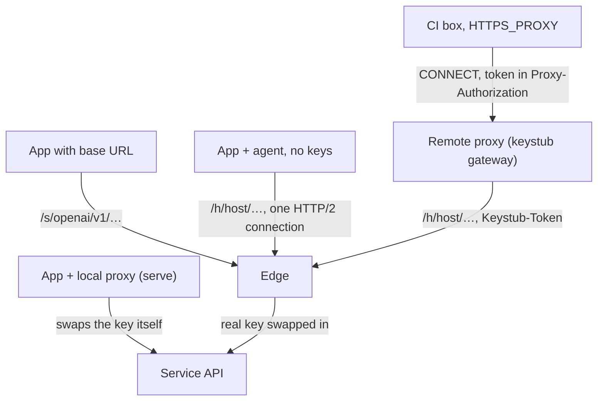

# Architecture

A box holds a proxy token (`sk-stub-…`), never a real key. Something on the request's path finds the token, checks it, and swaps in the real key for that service only.

## Modes

| Mode | On the box | Who swaps the key today |
| --- | --- | --- |
| Quick start | An SDK base URL pointing at the edge, plus the token as the API key | The edge (`/s/<service>/…`) |
| Agent | `keystub run`: `HTTPS_PROXY` to the local proxy, which decrypts service hosts with a local CA | The local proxy, with keys from its own server; or, forwarding with no keys (`keystub agent --remote`, `keystub run --remote`), the edge's `/h` route |
| Remote proxy | `HTTPS_PROXY=https://keystub:<token>@<gateway>`, plus the account's CA file; nothing installed | The edge's `/h` route, behind `keystub gateway` |
| Self-hosted | Any of the above, pointed at your own `keystub serve` | Your server |

### Agent with no keys

`keystub agent --remote <edge>` runs only the local proxy. It keeps the same `CONNECT`, TLS and stray-token handling as the proxy in `serve`; only "authorize and swap" is replaced: each decrypted request goes, unchanged, to `<edge>/h/<host>/<path>`, and the edge checks the token, counts limits and swaps the key. When the client sent a token in `Proxy-Authorization`, the agent adds it as `Keystub-Token`, which the edge prefers, so that token decides, as it does in `serve`. The box holds a local CA and a proxy token, never a real key, and keeps no state, master key, admin token or request log.

- **What to decrypt:** the agent asks the edge's `GET /catalog` with its token at start and every 5 minutes (services linked in the token's environment). Of those services' hosts it decrypts only the ones Keystub's built-in catalog (`catalog/services.json`) gives that same service, or ones the box allows with `--allow-host` / `$KEYSTUB_ALLOW_HOSTS`, and names the rest in a warning (at start, and on a refresh that lists new ones). The box, not the edge, says whose an allowed host is: `HOST` is only ever a custom service's, and `SERVICE=HOST` gives a built-in service its own server (`gitlab=gitlab.corp.example` for a self-hosted GitLab). Otherwise an edge could list `github` with an allowed internal host and have `GH_TOKEN` set to a token `gh` sends to github.com. A pinned host is that service's alone, like its catalog hosts: no custom service takes it, even under a wildcard the box also allowed. The agent refuses to start with a host two built-in services would share (`gitlab=x` and `github=x`, or `gitlab=api.github.com`), or a plain allowed host wholly under a pin, so the edge's order never picks a host's service. Pinning has the same cost wherever it's used: the service's variables (`GITLAB_TOKEN`, or `GH_TOKEN` for `github=ghe.corp.example`) are then the proxy token, so a tool that reads them for the public service too (gitlab.com, github.com) sends the token there untouched unless the edge also lists its public hosts. Every other host is tunnelled untouched, so a host the edge doesn't serve keeps working with the box's own credentials.
- **Trust boundary:** the edge holds the keys, but it doesn't choose what the box decrypts or what a command's environment holds. A compromised edge, or anyone who can add a custom service on it, can't make every box hand it `github.com`'s or an internal host's traffic: those need the box's own opt-in. Every service in the response is checked as a server checks one (its ID lowercased, so `Anthropic` is the built-in `anthropic`) and dropped if it fails. A built-in service's auth header, variables and base URL always come from the built-in catalog. A custom service may set only variables named like `FOO_KEY`, `FOO_TOKEN`, `FOO_SECRET` or `FOO_PASSWORD` (never `KEYSTUB_*`, nor one a built-in service reads, such as `GITHUB_TOKEN`), so it can't set `BASH_ENV`, `NODE_OPTIONS` or `HTTPS_PROXY`, and gets no base URL from a remote edge: one named `PIP_INDEX_URL` and pointed at the edge would let it serve code to installers. So `--direct` works for built-in services only; a custom one goes through the proxy. The rest are dropped with a warning. A host the built-in catalog gives a service, or the box pinned to it, is decrypted only as that service, even under a wildcard the box allowed (`--allow-host '*.googleapis.com'` never makes `generativelanguage.googleapis.com` a custom service's), so that service's own auth header is always guarded. `keystub run --token` and `keystub env --token` read the catalog this way from any server, the box's own `keystub serve` included; without a token they read the local server's dashboard API, which sets a custom service's variables as configured.
- **The box's own credentials in auth headers stay on it:** a decrypted request with no proxy token in `Proxy-Authorization` or its auth headers is refused (401). So is one whose auth header (`Authorization`, or the service's own: from the built-in catalog for a built-in service, the edge's choice for a custom one the box allowed) carries a credential besides a proxy token (400, "a real credential is set for …"): a value with no token, a second value beside it, or Basic auth whose password isn't the token (or a fixed word such as `X`). A scheme word before the token (`Bearer`, `Convex`, `DeepL-Auth-Key`) is fine, and a value that contains the token, like a template (`prod:my-app|sk-stub-…`), is forwarded as it is, whatever else is in that word. That holds under `keystub run` too, where every request carries a token in `Proxy-Authorization`. A request with no auth header goes on, and the edge writes the key. Other headers aren't checked: a cookie or a generic header with a secret in it reaches the edge with the request. Tools that send a real credential up front are refused rather than forwarded, for example npm with a real `_authToken` in `.npmrc`, or a client sending `Bearer undefined`. Two shapes pass on purpose: a first word of letters and dashes only (up to 32) before the token is taken for a scheme, though a real key with no digit would pass as one; and Basic auth with the token as the password passes whatever the user is (git's `x-access-token`).
- **Connection:** one long-lived HTTP/2 connection to an `https://` edge, with pings, shared by the catalog and every forwarded request. Bodies stream both ways. Websockets get an HTTP/1.1 connection of their own; `Expect: 100-continue` is answered at once, as in `serve`. An `http://` edge (a self-hosted one on loopback) gets HTTP/1.1 keep-alive.
- **Limits:** the remote must be `https://` (or `http://` on loopback). The agent listens on loopback only, since it can't check tokens itself. `/h/<host>` always means port 443, so a request for another port is refused (502).
- **Running commands:** `keystub agent` records its address and the services it decrypts in `agent.json`. `keystub run --token` leaves out the variables of any service the agent doesn't decrypt (its token is scoped to fewer), with a warning, rather than hand a stub token to a host that is tunnelled.
- **Linked machines:** `keystub link <server>` runs a device-code flow: the CLI shows a short code, an admin types it on the dashboard's Machines page, sees which machine it belongs to (name, address, time), and ticks the environments the machine may use, and the CLI receives the machine's own credential (`skmach_…`), stored in the macOS Keychain, else in `machine.json` (0600). With it, `keystub run` asks the server for this worktree's token (`POST /machine/tokens`) with no admin token and no `--token`, and goes through a running agent for that server or a private one; `keystub agent` needs no flags. Revoking the machine stops its credential and every token it got.
- **Sandboxes and CI:** `keystub run --token … --remote <edge> -- cmd` starts a private agent on a random loopback port for that one command, runs it as a child and exits with its status. With no `--remote`, `run --token` uses the running agent, else the running server, and needs no admin token.

The same code works against the Go edge and the hosted Worker: both serve `/h` and `/catalog` from [the protocol](../protocol/README.md).

### Remote proxy

For CI jobs and hosted sandboxes where nothing can be installed. The box sets `HTTPS_PROXY=https://keystub:<token>@<gateway>` and trusts one CA file, its account's. `keystub gateway` is the agent's forwarding mode run as one server for many accounts (`internal/gateway`): the same `CONNECT`, TLS and forwarding code, with a token check in front and one CA per account.

- **Every connection needs a live token**, tunnels included: the token in `Proxy-Authorization` is checked with the edge (`POST /gateway/check`, counted nowhere) before anything else, and the answer is trusted for 30 seconds (a refusal for 5). No token or a refused one gets 407 whatever the target (the target is looked at only after the check), so nothing can be probed without one. A request that isn't valid HTTP, such as a `Host` with `%` in it, gets 400 from the HTTP server before the gateway sees it.
- **Only port 443, only public addresses.** A `CONNECT` to another port is refused (403), so the gateway isn't a relay for mail or anything else, and one to a loopback, private, link-local, carrier-grade NAT or NAT64 address is refused after DNS (403), as `serve --require-token` does. Plain-HTTP proxying is refused (405): set `HTTPS_PROXY` only.
- **What it decrypts** is what an agent would for that token with no `--allow-host`: of the services the check lists, the hosts the built-in catalog gives that same service. Everything else is tunnelled untouched.
- **One CA per account.** The edge makes each account's CA on first use and stores its private key wrapped by the account key. The gateway fetches it (`POST /gateway/ca`) with the token that connected, and keeps it in memory only. The edge picks the CA by the token's own account (there is no way to name one), and the gateway files it under the account the token check named, refusing an answer for any other. So a connection is decrypted only with its own account's CA, and a box that trusts its account's CA trusts nothing that can sign for another account's traffic.
- **Forwarding:** each decrypted request goes, unchanged, to the edge's `/h/<host>/<path>` with the token in `Keystub-Token`, and the edge checks the token again, counts limits and swaps the key. The gateway holds no real keys and no counters, so limits stay shared with every other route.
- **The gateway's own credential** (`Keystub-Gateway-Key`) is sent to the `/gateway` routes only. Alone it opens no CA: both routes answer only for a live token's account.
- **Revocation:** every 30 seconds the gateway checks the tokens of open connections again and closes those the edge now refuses, so a revoked token's tunnels close within two check periods plus one recheck pass (a check trusted just before a pass is trusted through it), about a minute: a pass checks 64 tokens at once, so it takes seconds for the few thousand connections one machine holds; its decrypted requests stop at once, since the edge checks each. Only the edge's own refusal (401 with `"code": "token_refused"`) counts: any other 401 or 403, from something in front of the edge, is an edge problem, which closes nothing.
- **Under a flood of made-up tokens:** at most 256 checks of new tokens wait on the edge at once (503 past that), and refused tokens are kept apart from live sessions, so they can't push them out. Tokens that were live check again in slots of their own, so a flood doesn't cut off boxes already using the gateway; it can still turn new boxes away while it lasts.
- **What stays in memory:** CAs and sessions are dropped an hour after their last use (on the recheck tick), and the CA key's bytes are wiped once parsed.
- **TLS to the gateway:** the box's proxy URL is `https://`, so the token never crosses the network in the clear. On a platform that ends TLS in front (`--tls-in-front`) the gateway listens in plain text behind it; otherwise it needs `--tls-cert`/`--tls-key`, and refuses to listen off loopback without either.

Choosing the token check: the gateway asks the edge, rather than forwarding everything to `/h` and letting the edge decide, because tunnels never reach `/h`, and the CA has to be chosen before the TLS handshake, before any request exists. A check that counted nothing was the only way to refuse a tunnel without a token, and to know the account first.

## The CLI

`keystub keys|envs|tokens|services|usage|setup|ca`, and `login`, `logout`, `whoami`, are a client of [the control API](../protocol/api.md) (`internal/cli`), so they work the same against hosted and a self-hosted `keystub serve`. They are written for agents as much as people: `--json` everywhere, stable exit codes, no prompts without a terminal, and secrets read only from stdin, `--from-env` or a hidden prompt. `keystub help agents` prints the guide in [`llms.txt`](llms.txt). Hosted sign-in is a device code (`keystub login`), kept in `~/.keystub/cli.json` (0600); self-hosted uses the admin API key.

## The parts of `keystub serve`

| Listener | Default | What it does |
| --- | --- | --- |
| Proxy | `127.0.0.1:8787` | `CONNECT` proxy. Decrypts only hosts in the catalog and sends each request with the service's own Host header; tunnels everything else untouched. Off loopback, every connection must carry a live token (`--require-token`), and tunnels and plain HTTP can't reach loopback, private, link-local, carrier-grade NAT or NAT64 addresses |
| Edge | `127.0.0.1:8789` | `/s/<service>/…`, `/h/<host>/…` and `/catalog`, see [the protocol](../protocol/README.md). Plain HTTP: put TLS in front before exposing it |
| Dashboard | `127.0.0.1:8788` | Admin pages and the JSON API (`/api`, see [the control API](../protocol/api.md)) that the CLI and `keystub run` use; needs the admin token, as a bearer token for the API |

## Request path

Every route ends in the same check-and-swap:

1. Refuse a token sitting outside the auth headers (400): a service may store or echo other headers and so hand the real key back. Then find the token: `Proxy-Authorization` (proxy), the `Keystub-Token` header (edge), else the auth headers (`Authorization` and the service's own, e.g. `x-api-key` for Anthropic), also inside Basic auth, in either form (`sk-stub-…` or `skstub…`).
2. Check it: unknown or revoked → 401, expired → 401, not allowed for this service → 403.
3. Find the environment's link for the service and decrypt the saved key it names: no link → 502, can't decrypt → 500.
4. Count the request against the project, environment and token limits, and the saved key's if it has any, in one step: any full → 429, and nothing is counted.
5. Swap every token in the auth headers for the real key, keeping each value's shape. If none held a token, write the service's auth header.
6. Forward over verified TLS and stream the response back, scanning it for usage on the way by the catalog's metadata (never buffered). Log method, host, path, status, duration, Keystub's own time, and the operation, model, outcome, tokens, cost and quota read; never headers, query strings or bodies. See [usage](usage.md).

Steps 1 and 5 are pinned down by [`conformance/swap.json`](../conformance/swap.json), step 6's usage by [`conformance/usage.json`](../conformance/usage.json).

Known limit: a service that echoes its own auth header back (httpbin's `/headers`, a debugging endpoint) shows the real key to whoever holds the token. Don't put such services behind Keystub.

## Ports and adapters

`internal/core` decides everything and imports only the standard library. What depends on where Keystub runs sits behind a port, chosen in `cmd/keystub`:

| Port | Adapters | Contract test |
| --- | --- | --- |
| `Repository` | JSON file, SQLite | `storage/storagetest` |
| `Limiter` | memory, SQLite | `limit/limittest` |
| `Sink`, `LogReader` | JSON-lines file, SQLite | — |
| `usage.Reader` (hourly metrics) | in memory from the file, SQLite | — |
| `Sealer` | envelope encryption; master key from Keychain, env or file | — |

The proxy sees the core only as a `DataPlane` (look up a service, check a token, authorize a call), and as a `Catalog` (which hosts to decrypt) when it is an agent: there the catalog comes from the edge (`internal/agent`) and forwarding replaces the authorize step. The dashboard sees the core as a `ControlPlane`. `--storage sqlite` keeps the model, limit counts and request log in one `keystub.db`, so counts survive restarts; on first start it imports an existing `state.json`.
